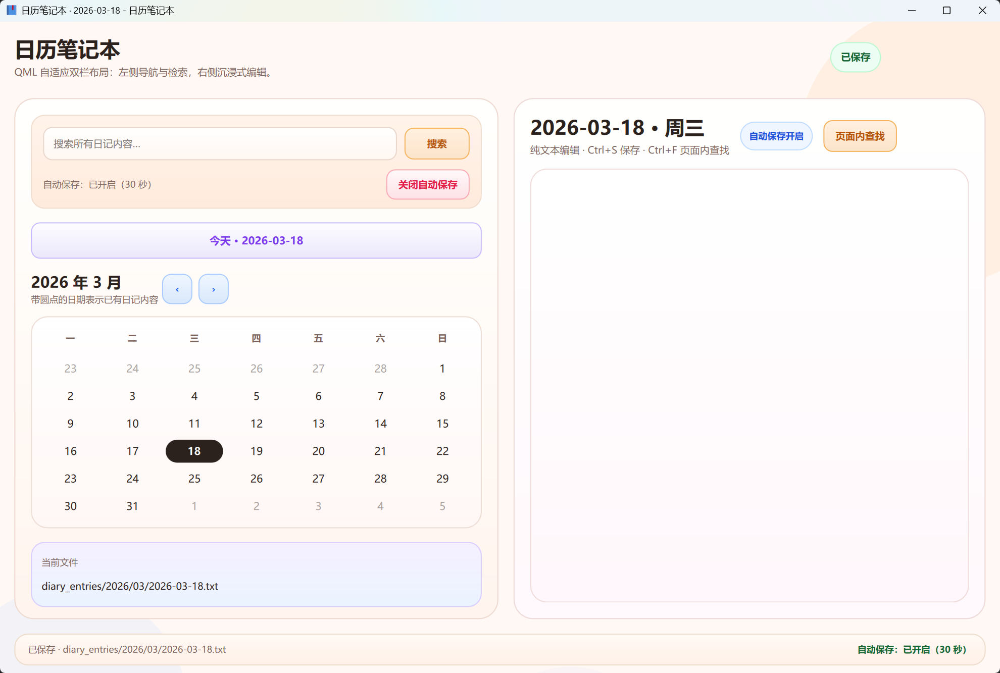

# 日历笔记本 (Calendar Diary)



这是一个基于 **PyQt6 + Qt Quick/QML** 的日历笔记本应用，支持通过日历快速切换日期、编辑纯文本日记，并将内容保存为 UTF-8 文本文件。`cpp/` 目录提供 Qt/C++ 移植版，`rust/` 目录提供 Rust + Tauri 移植版。

## 主要功能

- 响应式双栏 / 单栏主界面
- 日期切换、自动保存、未保存保护
- 全局全文搜索与页面内查找
- 新旧日记目录结构兼容迁移
- **浅色 / 深色模式切换，默认深色模式**
- 单应用实例：重复启动时自动激活已打开窗口

## 运行

```bash
python main.py
```

如果程序已经在运行，重复执行启动命令不会创建新窗口，而是恢复并前台化已有窗口。

日记默认保存到：

```text
diary_entries/YYYY/MM/YYYY-MM-DD.txt
```

## Qt/C++ 版本

```bash
cd cpp
xmake f -m release -y
xmake -y
```

C++ 版源码位于 `cpp/src/main.cpp`，构建脚本为 `cpp/xmake.lua`，打包参考 `cpp/xmake.ref.lua`。release 构建会调用 `windeployqt` 和 Enigma Virtual Box，单文件产物输出到：

```text
cpp/build/windows/x64/release/calendarNote_single.exe
```

## Rust/Tauri 版本

```bash
cd rust
npm install
npm run dev
```

no bundle release 构建：

```bash
npm run build:no-bundle
```

极限压缩构建会在 no bundle 后调用本机 UPX（未安装则跳过二次压缩）：

```bash
npm run build:tiny
```

产物输出到：

```text
rust/src-tauri/target/release/calendarNote.exe
```
